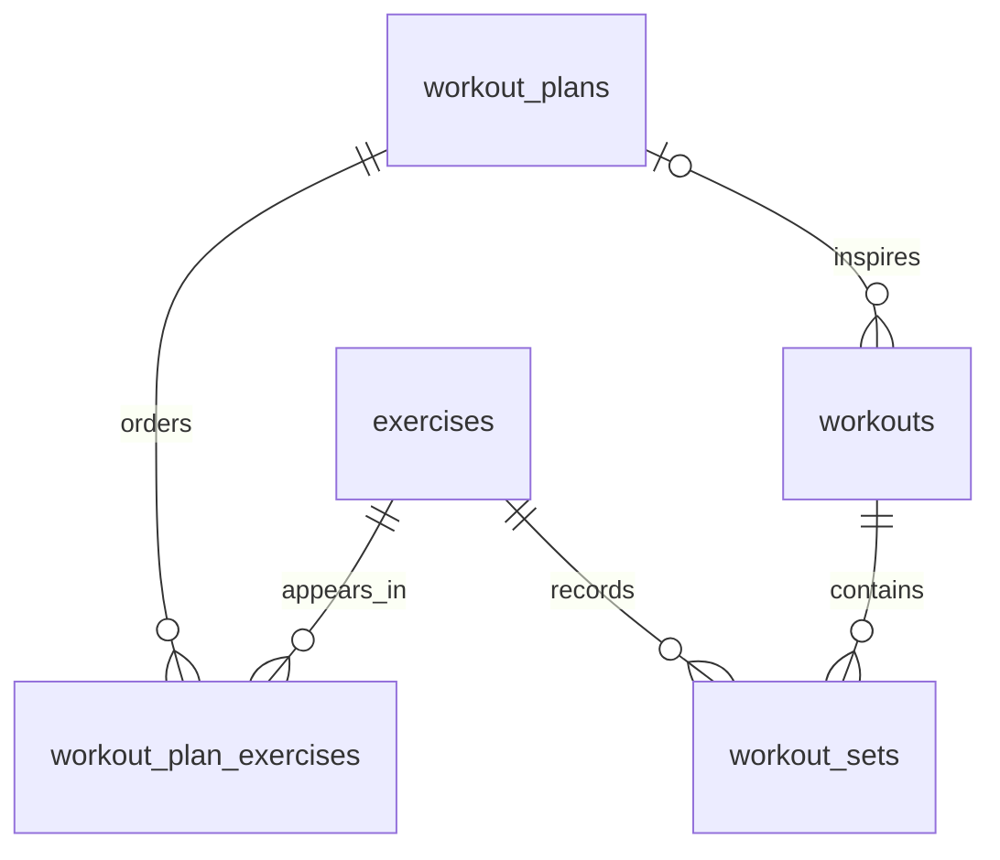

# Workout storage

Milestone 2 uses synchronous SQLAlchemy 2 sessions, psycopg 3, PostgreSQL 17,
and Alembic. The application remains API-first; this milestone adds storage
without exposing workout HTTP endpoints or integrating an LLM.

## Tables and relationships

| Table | Important columns and constraints |
| --- | --- |
| `exercises` | Integer `id`, nonblank unique `name` (120 characters); shared catalog. |
| `workout_plans` | Integer `id`, required UUID `user_id`, nonblank `name`; name unique per user. |
| `workout_plan_exercises` | Plan and exercise FKs; positive `position`, `target_sets`, `target_reps`; unique `(plan_id, position)`. |
| `workouts` | Integer `id`, required UUID `user_id`, optional `plan_id`, timezone-aware `started_at` defaulting to database time. |
| `workout_sets` | Workout and exercise FKs; positive `set_number` and `reps`, `NUMERIC(7,2)` `weight_kg`; unique `(workout_id, exercise_id, set_number)`. |

A plan is a reusable template for one session, not a multi-day calendar. Its
association rows preserve exercise order and targets. The same exercise can
appear at several positions. Actual sets store their own repetitions and weight;
editing a template never rewrites historical performance. A workout can be
unplanned or contain exercises outside its plan.

Set numbers start at 1 for each exercise within a workout. Weight means external
load in kilograms; zero means no external load, not zero body weight. Missing
load must not be silently interpreted as zero by future input handlers. Decimal
storage avoids binary floating-point artifacts. The weight constraint excludes
negative/non-finite values; 99999.99 is the column's storage limit, not a training
recommendation. This version supports repetition-based sets only; durations,
distance, and assisted negative loads are deferred.

## Ownership and deletion

`user_id` is an opaque UUID belonging to a future authenticated principal. There
is no local users table or authentication yet. A composite FK from
`workouts(plan_id, user_id)` to `workout_plans(id, user_id)` prevents attaching a
workout to another owner's plan. The ORM relationship writes only `plan_id`;
assigning a plan must not silently replace the workout's owner.

Sets inherit ownership through their workout; plan entries inherit it through
their plan. Exercises are shared catalog records. These constraints do not
authorize reads: future API queries must filter by the authenticated `user_id`,
including when looking up sets through their workout. Never trust an arbitrary
caller-provided owner UUID as authentication. No arbitrary SQL tool is exposed.

Deleting a workout cascades to its sets. Deleting an unused plan cascades to its
entries. A plan referenced by historical workouts cannot be deleted until it is
explicitly detached; ORM deletion must not detach it implicitly. Referenced
exercises cannot be deleted. No deletion endpoint is provided in this milestone.

Indexes support owner/date history lookups and per-exercise history. The unique
set index also supports retrieving all sets for a workout. Keep aggregate
statistics and fitness calculations in deterministic code in a later milestone.

## Configuration, transactions, and migrations

`DATABASE_URL` must use `postgresql+psycopg://...`; it is required only when
accessing storage. Importing the FastAPI app or calling `/health` does not connect
to PostgreSQL. `uv run --env-file .env ...` explicitly loads local configuration.
The Python modules themselves do not load dotenv files or create tables at import.
SQL parameter values are hidden in engine error diagnostics.

Use `create_db_engine()` and a SQLAlchemy `Session`. The caller owns transaction
boundaries: `with Session(engine) as session, session.begin(): ...` commits on
success and rolls back on failure. Treat a multi-set workout as a transaction.
Only report storage success after the commit succeeds. Future AI-proposed
changes will still need explicit user confirmation before entering that write
transaction.

Alembic revision `0001` creates the five tables and constraints. Schema is never
created by application startup. Run `alembic upgrade head` before accessing data;
`alembic check` detects model/migration drift. For future schema changes, generate
and review a new revision instead of editing an already applied migration.
Downgrading to `base` drops these tables and is destructive; it is exercised only
in disposable test schemas.

Compose bootstraps a dedicated non-superuser `gym_app` role using local passwords.
It owns its tables and can create schemas for local migrations/tests. That is a
development permission set; deployment should separate migrations/tests from a
runtime role with only required data permissions. PostgreSQL stays on loopback.

## Verification and synthetic data

Persistence tests require `TEST_DATABASE_URL` and use PostgreSQL itself. Each test
creates an unpredictable schema, applies migrations through the same connection
configuration, and cleans up only its own schema. A configured but unavailable
database is a failure, not a skip. No SQLite substitute is used.

Run `uv run --env-file .env --locked pytest`. The suite checks persistence across
sessions, rollback, ordered plans, optional plans, cross-owner rejection (including
ORM assignment), numeric/FK/uniqueness constraints, deletion behavior, and seed
repeatability. Migration tests check upgrade/downgrade and `alembic check`.

`python -m app.seed` is an explicit opt-in to synthetic data, not an automatic
startup action. The fixed demo owner UUID and demo-prefixed exercises distinguish
fixtures from real users. No personal workout history is imported.
