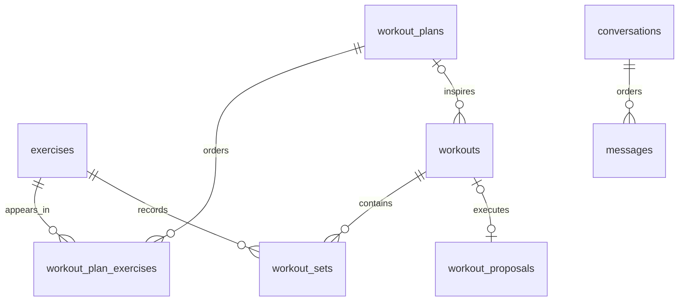

# Database storage

Storage uses synchronous SQLAlchemy 2 sessions, psycopg 3, PostgreSQL 17,
and Alembic. Migration head `0005` defines eight tables for workout/catalog data,
proposal consent/execution, and conversation history. Workout HTTP APIs and the
bounded LLM agent are implemented; conversation storage is not yet connected to
HTTP chat. See [PROJECT_CONTEXT.md](PROJECT_CONTEXT.md) for application boundaries.

## Tables and relationships

| Table | Important columns and constraints |
| --- | --- |
| `exercises` | Integer `id`, nonblank unique `name` (120 characters); shared catalog. |
| `workout_plans` | Integer `id`, required UUID `user_id`, nonblank `name`; name unique per user. |
| `workout_plan_exercises` | Plan and exercise FKs; positive `position`, `target_sets`, `target_reps`; unique `(plan_id, position)`. |
| `workouts` | Integer `id`, required UUID `user_id`, optional `plan_id`, timezone-aware `started_at` defaulting to database time. |
| `workout_sets` | Workout and exercise FKs; positive `set_number` and `reps`, `NUMERIC(7,2)` `weight_kg`; unique `(workout_id, exercise_id, set_number)`. Revision `0003` adds nullable positive `position`, unique within each workout. |
| `workout_proposals` | Server-generated UUID `id`, UUID owner, JSONB payload, lifecycle state, and timezone-aware creation/expiration/resolution times; added in revision `0002`. Revision `0003` adds nullable unique `workout_id`, restricted to confirmed proposals and referencing a same-owner workout. |
| `conversations` | UUID `id` generated by the ORM, required UUID `user_id`, timezone-aware database-default `created_at`; index on `(user_id, created_at)`. Added in revision `0004`. |
| `messages` | Integer `id`, required conversation FK, positive `position` unique within a conversation, role, text, and timezone-aware database-default `created_at`. Added in `0004`; `0005` adds JSONB `tool_calls`, text `tool_call_id`, the `tool` role, and conditional nullable assistant content. |

A plan is a reusable template for one session, not a multi-day calendar. Its
association rows preserve exercise order and targets. The same exercise can
appear at several positions. Actual sets store their own repetitions and weight;
editing a template never rewrites historical performance. A workout can be
unplanned or contain exercises outside its plan.

Set numbers start at 1 for each exercise within a workout. Weight means external
load in kilograms; zero means no external load, not zero body weight. Missing
load must not be silently interpreted as zero by future input handlers. Decimal
storage avoids binary floating-point artifacts. The weight constraint excludes
negative/non-finite values; 99999.99 is the column's storage limit, not a training
recommendation. This version supports repetition-based sets only; durations,
distance, and assisted negative loads are deferred.

Proposal-executed sets also have a global `position` starting at 1, preserving
interleaved exercise order. Reads sort by position first, then exercise/set number
for legacy or manually added sets whose position is null. No legacy order is invented.

## Ownership and deletion

`user_id` is an opaque UUID belonging to a future authenticated principal. There
is no local users table or authentication yet. A composite FK from
`workouts(plan_id, user_id)` to `workout_plans(id, user_id)` prevents attaching a
workout to another owner's plan. The ORM relationship writes only `plan_id`;
assigning a plan must not silently replace the workout's owner.

Sets inherit ownership through their workout; plan entries inherit it through
their plan. Exercises are shared catalog records. These constraints do not
authorize reads: existing workout/proposal queries filter by a server-selected
demo owner, and future conversation operations must check that owner too.
Real authentication must eventually supply the trusted `user_id`. Never trust an
arbitrary caller-provided owner UUID as authentication. No arbitrary SQL tool is exposed.

Deleting a workout cascades to its sets. Deleting an unused plan cascades to its
entries. A plan referenced by historical workouts cannot be deleted until it is
explicitly detached; ORM deletion must not detach it implicitly. Referenced
exercises cannot be deleted. No deletion endpoints are currently implemented.

Indexes support owner/date history lookups and per-exercise history. The unique
set index also supports retrieving all sets for a workout. Exercise statistics
are implemented through owner-scoped reads in `app.queries` and deterministic
Decimal calculations in `app.progress`, exposed by `get_exercise_progress`.

## Configuration, transactions, and migrations

`DATABASE_URL` must use `postgresql+psycopg://...`; it is required only when
accessing storage. Importing the FastAPI app or calling `/health` does not connect
to PostgreSQL. `uv run --env-file .env ...` explicitly loads local configuration.
The Python modules themselves do not load dotenv files or create tables at import.
SQL parameter values are hidden in engine error diagnostics.

Use `create_db_engine()` and a SQLAlchemy `Session`. The caller owns transaction
boundaries: `with Session(engine) as session, session.begin(): ...` commits on
success and rolls back on failure. Treat a multi-set workout as a transaction.
Only report storage success after the commit succeeds. AI-proposed workout
writes already require a separate explicit human confirmation action; the chat
agent can store pending proposals but cannot confirm or execute workouts.

Alembic revision `0001` creates the five workout/catalog tables and constraints;
revision `0002` adds the proposal table, and `0003` adds the execution link and
global set positions with nullable defaults for existing records. Schema is never
created by application startup. Revision `0004` only adds conversations/messages
and their index/constraints; it does not modify existing workout data.
Revision `0005` adds tool metadata and updates only message constraints/nullability;
existing conversation text and all workout/proposal tables are preserved.
Run `alembic upgrade head` before accessing data;
`alembic check` detects model/migration drift. For future schema changes, generate
and review a new revision instead of editing an already applied migration.
Downgrading to `base` drops these tables and is destructive; it is exercised only
in disposable test schemas.

Compose bootstraps a dedicated non-superuser `gym_app` role using local passwords.
It owns its tables and can create schemas for local migrations/tests. That is a
development permission set; deployment should separate migrations/tests from a
runtime role with only required data permissions. PostgreSQL stays on loopback.

## Proposal snapshots and human decisions

`workout_proposals` stores snapshots separately from workout/set records. Only fully resolved,
complete proposals can enter the store. JSONB preserves set-list order and
Decimal weights as strings; it contains validated sets rather than LLM prose.
State is `pending`, `confirmed`, `rejected`, or `expired`. Checks enforce known
states, object payloads, expiration after creation, and a resolution timestamp
exactly when state is terminal. UUID IDs are generated by server code; ownership
is always part of lookup predicates. No users table or authentication is added.

Lifecycle operations use Core INSERT/UPDATE statements, suppress ORM autoflush,
and touch only this table. The caller controls the transaction and reports
success after commit. Row locks serialize decisions; PostgreSQL wall-clock time
is read after acquiring the lock. A pending record expires at the deadline,
including during a lock wait. Expiration is persisted lazily by reads/decisions;
it needs no background worker. Confirmed/rejected/expired records remain terminal
and retain the original snapshot. The low-level decision function rejects
repeated terminal decisions; HTTP confirm/reject returns the existing result for
the same decision and rejects an opposite decision. No snapshot-edit operation is exposed.

The low-level store records consent only; it never creates a workout or set.
The HTTP confirm route combines that decision with the executor below in one
transaction, committing consent and workout data together. Reject creates no
workout. These store/executor functions are not LLM tools. Snapshots intentionally
have no exercise FKs that could delete or rewrite historical consent.

## Atomic execution and idempotency

`app.workout_execution.execute_confirmed_workout` accepts only stored confirmed
consent for the server-selected owner. It reuses the proposal row lock and validates
the typed snapshot again. The confirmation deadline is checked when consent is
recorded; execution/retries do not expire an already-confirmed decision.

Before first execution, catalog IDs and names must still match the reviewed
snapshot. Catalog rows are locked `FOR SHARE` until transaction completion to
prevent rename/delete races. A mismatch requires a new proposal and consent.
The executor creates one unplanned workout, all ordered sets, and the proposal's
execution link in the caller's single transaction, using Core DML with autoflush
disabled. Errors must propagate out of `session.begin()` so all changes roll back;
only report success after commit. No LLM request is made; execution requires
existing explicit consent and the trusted server-selected owner.

The nullable unique proposal `workout_id` is the durable execution marker. A
composite FK to `workouts(id, user_id)` enforces equal ownership, and a check
requires linked proposals to be confirmed. `ON DELETE RESTRICT` protects linked
workouts from deletion while referenced. Concurrent executions serialize on the
proposal lock; later calls return the existing owner-scoped workout and ordered
sets. Repeated confirmation returns this existing execution without changing
the terminal consent state or creating duplicate workouts.

## Conversation history

Revision `0004` adds the first Milestone 6 storage layer. A conversation belongs
to one server-selected owner; messages inherit ownership through their parent.
Every future conversation lookup must filter by both conversation ID and trusted
user ID, and message access must check that parent. UUIDs, foreign keys, and ORM
relationships do not authorize reads or writes. Authentication remains planned.

The bidirectional `Conversation.messages` / `ConversationMessage.conversation` relationship
loads messages by ascending `position`. Timestamps are not an ordering key:
several messages can share the same timestamp. The unique constraint on
`(conversation_id, position)` also provides the index for ordered message reads.
Future append operations must allocate positions safely under concurrency; the
models do not allocate them. Deleting a conversation cascades to its messages
in PostgreSQL and through the ORM; removing a message from the collection deletes
that orphan. No deletion API is provided.

`ConversationMessage` maps the existing `messages` table; `Message` remains an
import alias. Revision `0005` supports `user`, `assistant`, and `tool` roles:

- User messages require nonblank text and no tool metadata.
- Assistant messages accept nonblank text, a nonempty JSONB `tool_calls` array,
  or both. Only a tool-calling assistant message may have NULL content.
- Tool results require nonblank text and a nonblank `tool_call_id`, with no
  `tool_calls`. Results reference the ID in the assistant's call metadata.

`JSONB(none_as_null=True)` stores Python `None` as SQL NULL; a JSON null is rejected.
Database checks enforce the metadata container and role/field combinations, not
individual call-object schemas or cross-message call-ID matching. Future storage
operations must validate those details and ownership; metadata never grants tool
execution permission. Position allocation remains a separate concurrency concern.
Downgrade to `0004` locks the message table and refuses to proceed if tool metadata
or tool-only content would be lost. Legacy text-only rows can round-trip unchanged.

Structured proposal responses and system instructions are not stored. Proposal
snapshots and explicit consent remain authoritative in `workout_proposals`;
conversation text must never authorize workout writes. There is no chat persistence
service, HTTP contract change, history/context loading, or LLM integration yet.

## Verification and synthetic data

Persistence tests require `TEST_DATABASE_URL` and use PostgreSQL itself. Each test
creates an unpredictable schema, applies migrations through the same connection
configuration, and cleans up only its own schema. A configured but unavailable
database is a failure, not a skip. No SQLite substitute is used.

Run `uv run --env-file .env --locked pytest`. The suite checks persistence across
sessions, rollback, ordered plans, optional plans, cross-owner rejection (including
ORM assignment), numeric/FK/uniqueness constraints, deletion behavior, and seed
repeatability. Migration tests check upgrade/downgrade and `alembic check`.

`python -m app.seed` is an explicit opt-in to synthetic data, not an automatic
startup action. The fixed demo owner UUID and demo-prefixed exercises distinguish
fixtures from real users. No personal workout history is imported.
